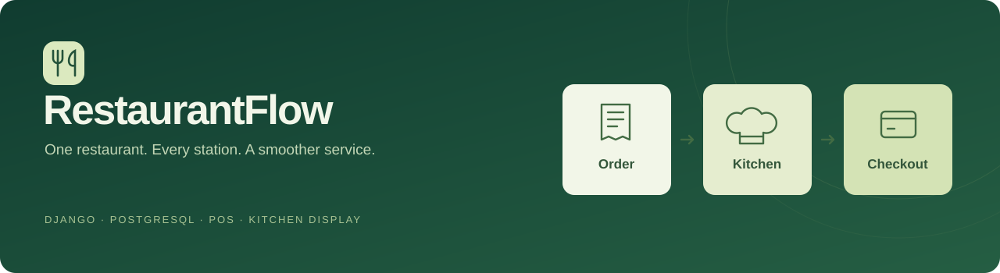
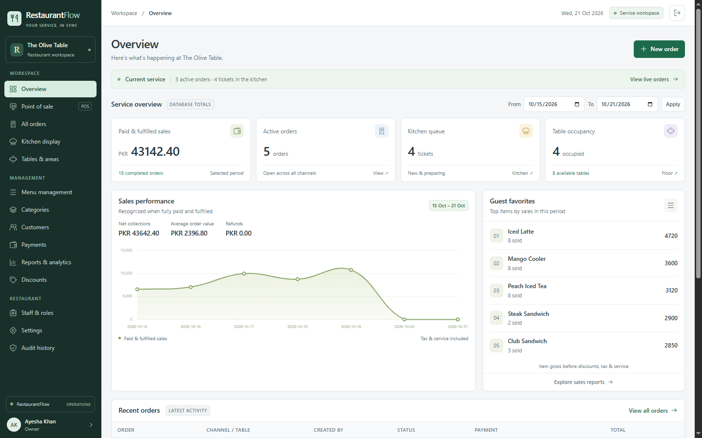
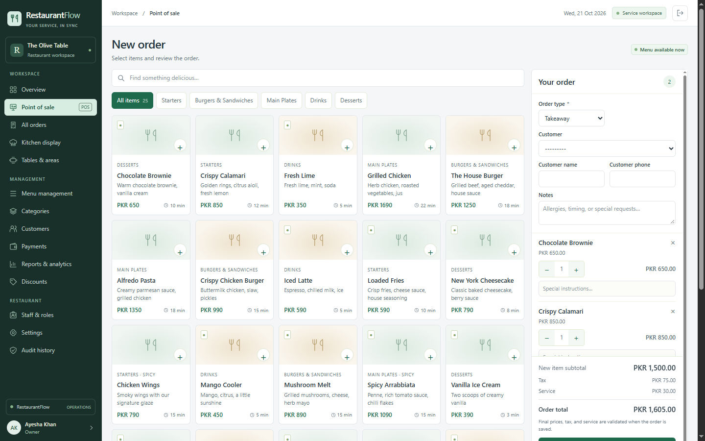

<p align="center"></p>

# RestaurantFlow

[](https://github.com/Shozab-110/restaurantflow/actions/workflows/ci.yml)

A Django and PostgreSQL restaurant POS that connects the dining room, kitchen, and cashier. Staff work from one shared order record, with persistent transactions, role permissions, kitchen tickets, and a custom administration frontend.

Built for a single restaurant per installation. This is a working MVP with automated workflow tests; deployment-specific acceptance is still required before live business use.

## What you can do

| Area | Implemented behavior |
|---|---|
| POS | Dine-in, takeaway, delivery, searchable menu, quantities, instructions, additional kitchen submissions |
| Kitchen | Five-second partial updates, overdue tickets, preparation and ready transitions, service/handoff |
| Billing | Decimal totals, price/tax/currency snapshots, discounts, partial and multiple payments, retry protection |
| Restaurant operations | Visual tables and areas, menu/categories, image uploads, customers, order history |
| Administration | Staff and roles, account activation, password resets, restaurant settings, audit history |
| Reports | Date filters, sales, collections, outstanding balances, items/categories/cashiers, kitchen performance, CSV |
| Receipts | Itemized, print-friendly HTML receipts with restaurant details and payment breakdown |
| Security | Session login, CSRF, server-side permissions, login throttling, transaction locks, validated uploads |

Payments and refunds are manually confirmed records. There is no live payment gateway. Normal business administration uses the application frontend; Django Admin is optional technical maintenance.

## Application preview

The compact interface uses smaller headings, tighter spacing, denser tables and a persistent POS cart. Touch controls stay larger on phones and tablets.





Actual local Django-rendered demo fixtures captured in headless Chrome, not VPS screenshots. See [capture details and device verification limits](docs/SCREENSHOTS.md).

## Start with Docker

Install Git, Python 3.12, and a running Docker Engine with Compose v2. Docker Desktop account sign-in is not required for the local application.

```bash
git clone https://github.com/Shozab-110/restaurantflow.git
cd restaurantflow
python scripts/configure_local.py
docker compose config --quiet
docker compose up -d --build --wait
docker compose exec web python manage.py create_owner --username owner
```

Open **[http://127.0.0.1:8000](http://127.0.0.1:8000)** and sign in with the owner password you chose at the hidden prompt. No shared owner password is published. The configuration helper generates local secrets and refuses to overwrite an existing `.env`.

PostgreSQL stays inside the Docker network and stores records in a persistent volume. `docker compose down` retains data. See [Getting started](docs/GETTING_STARTED.md) for native Python, a host-accessible Docker database, existing PostgreSQL, safe demo setup, and Windows commands.

## Follow an order

For an **internet-free, multi-device demo**, use [Offline laptop + phones/tablets](docs/OFFLINE_DEMO.md). The original Windows checkout includes **Start Offline Demo.cmd** and a scoped Windows LAN-access helper. For future code uploads, follow [Making changes and pushing](docs/GIT_WORKFLOW.md).

1. **Dine-in:** waiter selects a table, adds items, and submits a kitchen ticket. Kitchen starts preparation and marks it ready. Waiter serves it; cashier prints the bill and records payment. Full settlement and fulfillment close the order and release the table.
2. **Takeaway / delivery:** cashier creates an order, kitchen prepares it, cashier collects payment and confirms handoff. Delivery requires customer contact and address.
3. **Cancellation:** an authorized manager or owner provides a reason. Any collected money must be returned manually and confirmed before the system records the cancellation and refunds together.

See [daily operations and accounting rules](docs/OPERATIONS.md) for service, payment, discount, and cancellation behavior.

## Staff roles

| Role | Access |
|---|---|
| Owner | All business operations, settings, staff/roles, reports, audit |
| Manager | Menu, tables, orders, customers, reports, discounts/cancellations; operational staff management |
| Cashier | POS, orders, service/handoff, billing/payments, customers, dashboard and own payment activity |
| Waiter | Assigned/unassigned available tables, own/assigned dine-in orders, submission, serving, bill requests |
| Kitchen Staff | Kitchen queue and preparing/ready transitions |

Owners use regular Django accounts with group permissions. Views and transactional services enforce access. Create subsequent users through **Staff & Roles**, choose their role, and set an initial password. Inactive accounts cannot log in.

## Technology and data

Python 3.12, Django 5.2 LTS, PostgreSQL 17, Django templates, Tailwind CSS, HTMX, Alpine.js, Chart.js, Django Axes, Gunicorn, WhiteNoise, and Docker Compose. Caddy provides the optional HTTPS reverse proxy. Python and Node dependencies have lockfiles. Compiled frontend assets are included for native Python startup.

There is **no SQLite fallback**. Orders snapshot prices and billing settings; protected historical references preserve previous transactions when the menu changes. Critical operations use PostgreSQL row locks, unique constraints, and database transactions. Payment retry tokens prevent duplicate ledger entries.

```text
restaurantflow/      Environment-based Django configuration
operations/          Models, forms, permissions, views, reporting
  services.py        Ordering, kitchen, payment and cancellation rules
  migrations/        Versioned PostgreSQL schema
  tests/             Business, frontend, security and concurrency tests
templates/           Custom business pages and shared design system
assets/              Tailwind input
static/              Compiled CSS, local libraries and application JS
scripts/             Setup, assets, initialization and verification
deploy/              HTTPS proxy configuration
docs/                Setup, operations, design and deployment guides
```

Learn [where the database lives and how to view tables](docs/DATABASE.md), or inspect the [architecture and workflow diagrams](docs/ARCHITECTURE.md). Database binaries, live records, uploads, `.env`, and generated credentials are excluded from Git.

## Verification

The latest local acceptance run passed **31 PostgreSQL workflow/security/concurrency tests** and **12 configuration/planner tests**. Live VPS checks also passed real staff logins, owner administration, dine-in/takeaway kitchen and payment workflows, cancellation, receipts, CSV, database privileges and an isolated backup restore. Exact evidence and remaining device/operational checks are recorded in [PROGRESS.md](PROGRESS.md).

GitHub Actions runs locked dependency installation, frontend compilation, PostgreSQL tests, POS interaction checks, production settings checks, and a Docker stack smoke test on Linux. Its actual result is linked by the badge above; a workflow file alone is not proof of a passing run.

The [verified Linux CI run](https://github.com/Shozab-110/restaurantflow/actions/runs/39611389128) on application commit `13580e7` passed all **48 automated tests** (31 PostgreSQL, 12 configuration/planner, 5 POS DOM), built the Docker image, started PostgreSQL/Gunicorn, and verified health, login, owner initialization, and container production checks.

```bash
python manage.py check
python manage.py makemigrations --check --dry-run
python manage.py test operations.tests --noinput --verbosity 2
python -m unittest discover -s tests -v
python scripts/check_docs.py
```

See [Testing](docs/TESTING.md) for requirements, frontend tests, and production configuration checks. See [Findings and solutions](docs/FINDINGS_AND_SOLUTIONS.md) for the actual setup issues, causes, fixes, and remaining verification gaps.

## Documentation

| Guide | Contents |
|---|---|
| [Getting started](docs/GETTING_STARTED.md) | Docker/native setup, owner account, demo data |
| [Offline demo](docs/OFFLINE_DEMO.md) | Laptop server, phone/tablet login, local Wi-Fi, firewall, VPS comparison |
| [Git workflow](docs/GIT_WORKFLOW.md) | Make changes, review, commit, push, and distinguish code from database records |
| [Operations](docs/OPERATIONS.md) | Staff workflows and accounting rules |
| [Database](docs/DATABASE.md) | Storage location, schema, PostgreSQL/pgAdmin access |
| [Architecture](docs/ARCHITECTURE.md) | Application layers, invariants, workflow diagrams |
| [Testing](docs/TESTING.md) | Automated checks and reproducible commands |
| [Findings and solutions](docs/FINDINGS_AND_SOLUTIONS.md) | Problems encountered and verified fixes |
| [Troubleshooting](docs/TROUBLESHOOTING.md) | Login, Docker, database, assets, business-rule errors |
| [Deployment](docs/DEPLOYMENT.md) | Ubuntu, HTTPS, secrets, health, backup and restore |
| [Cohosting](docs/COHOSTING.md) | Isolated deployment beside an existing ERP, IP HTTPS, protected ports and database roles |
| [Existing shared proxy](docs/SHARED_PROXY.md) | Keep a managed 443 service intact, use HTTPS 8443, preserve ERP routing, and operate the correct Compose stack |
| [Screenshots](docs/SCREENSHOTS.md) | Actual capture checklist and current visual QA limits |
| [Progress](PROGRESS.md) | Completed work, test evidence, pending acceptance |

The banner is a project illustration. The application screenshots above use synthetic local demonstration records.

## Scope and remaining work

- One restaurant per installation. Inventory, purchasing, formal cash-drawer shifts, split checks, table transfers, independent offline device queues/synchronization, and dispatch integrations are future work. Laptop-hosted offline LAN use is supported.
- Closed orders are immutable. Post-close accounting adjustments need a controlled external process in this MVP.
- Order-wide tax/service apply to the discounted subtotal with half-up rounding; no item-specific tax regimes, inclusive pricing, or currency conversion.
- HTML printing and browser Save as PDF are supported; dedicated PDF generation and kitchen sound alerts are deferred.
- Production acceptance still requires actual DNS/TLS, restricted runtime database privileges, external backups and restore rehearsal, expected-load checks, browser/tablet review, and receipt-printer testing. Local checks do not certify an installed production environment.

## Contributing and security

Read [CONTRIBUTING.md](CONTRIBUTING.md), [SECURITY.md](SECURITY.md), and [CHANGELOG.md](CHANGELOG.md). Use sanitized examples in issues. Never upload customer records, passwords, `.env`, or database dumps.

No project-wide open-source license has been selected yet. Bundled third-party notices remain with their assets.
