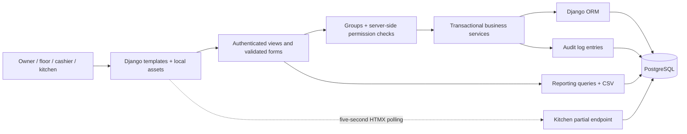
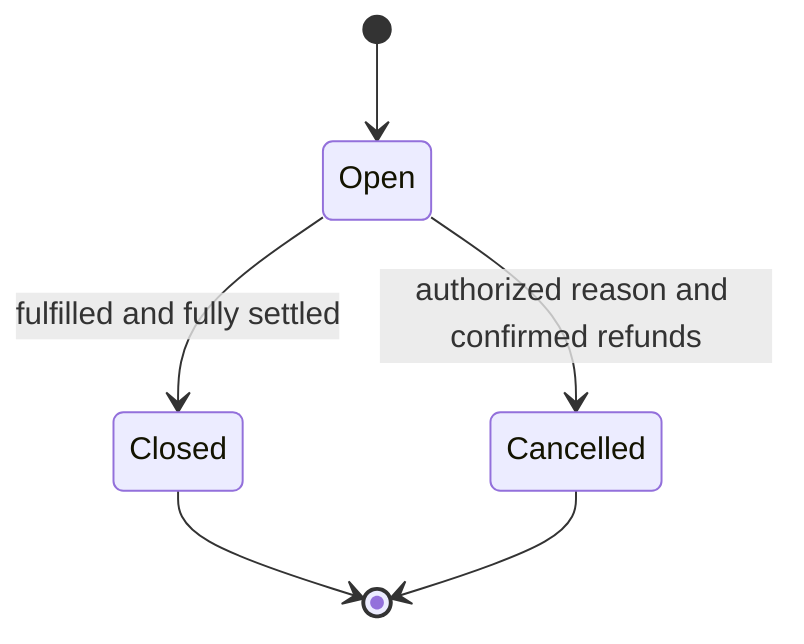
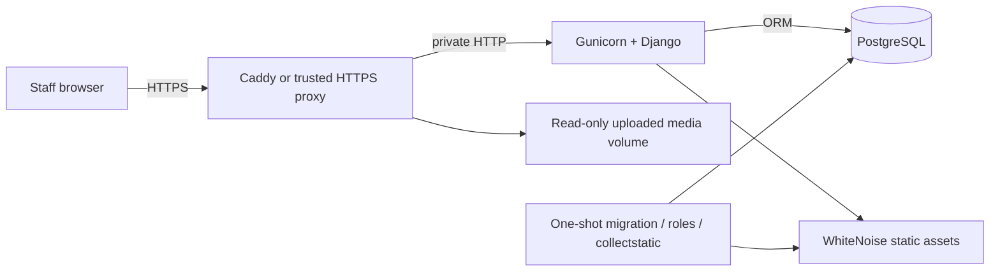

# Architecture and business invariants

RestaurantFlow is a single-restaurant Django application. It uses Django templates for the UI and PostgreSQL for persistent business records. Django Admin is an optional maintenance interface; normal business administration uses the custom frontend.

## Request and data flow

| Layer | Location | Responsibility |
|---|---|---|
| Configuration | `restaurantflow/settings.py` | Environment, PostgreSQL, sessions, security, assets, logging |
| Schema | `operations/models.py`, migrations | Relations, historical protection, indexes, constraints |
| Authorization | `operations/permissions.py` | Role capabilities, order visibility, service guards |
| Validation/UI | `operations/forms.py`, `views.py`, templates | Typed input, uploads, permission-protected custom pages |
| Business transactions | `operations/services.py` | Prices, totals, tickets, payments, fulfillment, refunds |
| Reports | `operations/reporting.py` | Date/currency boundaries and reconciled aggregates |
| Browser behavior | `static/js`, `assets/input.css` | POS cart previews, charts, polling and shared design |
| Operations | `scripts/`, Compose, `deploy/` | Initialization, build, health, startup and reverse proxy |

## Order states are separate

Kitchen ticket state is `new → preparing → ready → completed`, with explicit cancellation where appropriate. Fulfillment is `pending → served` for dine-in or `pending → handed_over` for takeaway/delivery. Payment status is derived from the order balance and refund state. A ticket being ready does not imply that the bill is paid or that a table can be released.

## Critical invariants

1. **One open dine-in session per table.** Creation locks the table row and checks availability; a conditional unique PostgreSQL constraint provides a second barrier.
2. **Historical amounts do not follow menu edits.** Each order item snapshots its name/category/unit price/tax rate. Orders snapshot currency and tax/service rates.
3. **Money is exact.** Python Decimal is authoritative. Client previews use integer minor units, and saving recomputes prices/totals on the server.
4. **Only unsent items create a new ticket.** One-to-one ticket lines prevent reusing the same order item. Dispatch tokens prevent duplicate ticket creation on retries.
5. **Payments are append-only business records.** Order row locks, unique request keys, payload matching, and balance checks prevent duplicates and overpayment. A settings-row lock also serializes cross-order payment-token collisions.
6. **Cashier actions do not silently remove history.** Draft lines can be edited; submitted lines require an authorized reasoned void. Cancelled orders remain visible.
7. **Refunds correspond to original collections.** Each refund references one original payment; cancellation is transactional and retry-safe. The operator must actually return funds outside the application before confirmation.
8. **A table releases only on completed settlement/fulfillment or cancellation.** Serving an unpaid dine-in order leaves the table occupied. Takeaway/delivery handoff requires full payment.
9. **Roles are enforced beyond navigation.** Views and services check permissions and order scope. Managers cannot administer owner/manager accounts through the normal frontend.
10. **Currencies are not combined.** Reports select one currency. Changing the configured currency requires settling open orders.

## Deployment topology

The default Compose web port binds to loopback. PostgreSQL is internal unless the explicit development override is used. The production guide describes credential separation, HTTPS trust, logging, and backups. This topology is configuration, not proof that a particular VPS has been verified.

## Deliberate MVP boundaries

There is no inventory service, message broker, external payment gateway, offline synchronization, or multi-tenant architecture. Kitchen updates use polling. Receipt output is print-friendly HTML. Closed-order adjustments, formal shifts, split checks, and advanced tax regimes are deferred; see [Operations](OPERATIONS.md) and [Findings](FINDINGS_AND_SOLUTIONS.md).
