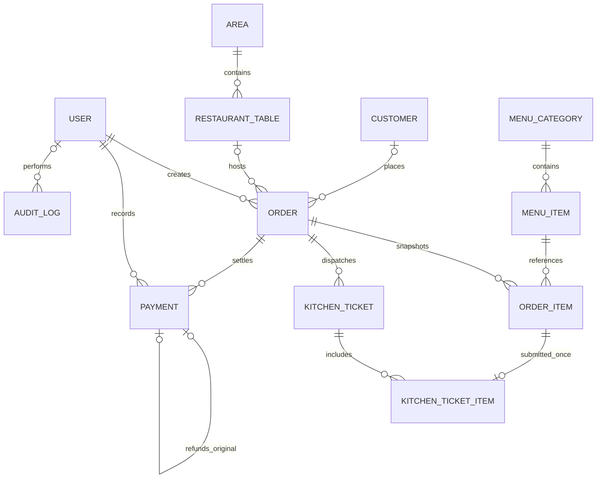

# PostgreSQL and where data lives

The website and database use different protocols and ports. The app's browser address is normally **http://127.0.0.1:8000**. PostgreSQL's port is for a database client, not a website.

## Storage by installation

| Installation | PostgreSQL address used by Django | Actual data storage |
|---|---|---|
| Original Windows portable setup | `127.0.0.1:5433` | `.local/pgdata` in that checkout |
| Complete Compose stack | `db:5432` inside its network | Named `postgres` Docker volume |
| Host Django + dev Compose database | `127.0.0.1:${POSTGRES_PORT}` (default 5433) | Named `postgres` Docker volume |
| Existing PostgreSQL server | Host/port configured in `.env` | That PostgreSQL server's configured data directory |

Database names default to `restaurantflow`. A fresh Git clone includes schema migrations and synthetic seed code; it does not include an existing database, staff accounts, `.env`, or uploaded images. PostgreSQL persists data independently of a browser tab or a Django process restart.

## Main tables

| Actual PostgreSQL table | Meaning |
|---|---|
| `auth_user`, `auth_group`, `auth_user_groups` | Staff identities and role membership; passwords are hashed |
| `operations_restaurantsettings` | Restaurant identity, currency/timezone, receipt and charge defaults |
| `operations_restaurantarea`, `operations_restauranttable` | Dining areas, tables, capacities, assignments, availability |
| `operations_menucategory`, `operations_menuitem` | Menu categories and current product information/prices |
| `operations_customer` | Customer contact records |
| `operations_order`, `operations_orderitem` | Order headers and historical item snapshots |
| `operations_kitchenticket`, `operations_kitchenticketitem` | Kitchen submissions and their exact item lines |
| `operations_payment` | Collections and linked refund records |
| `operations_discount` | Saved percentage offers |
| `operations_auditlog` | Staff action history and reasons |
| `operations_userprofile` | Optional extended staff profile records |

## Relationships



## Inspecting records

Use pgAdmin, another PostgreSQL client, or Django's read-only ORM queries for technical inspection. Normal staff should manage records through RestaurantFlow's custom frontend.

The original checkout has a local pgAdmin instance at **http://127.0.0.1:5050** with a registered `RestaurantFlow - Read only` connection. It uses a distinct SELECT-only PostgreSQL role. Expand:

```text
RestaurantFlow
  RestaurantFlow - Read only
    Databases
      restaurantflow
        Schemas
          public
            Tables
```

Right-click a business table and choose **View/Edit Data → All Rows** to inspect the grid. Viewer configuration/password files remain under ignored `.local/pgadmin`; a new clone does not automatically install or start this optional tool. pgAdmin's own configuration metadata is separate from RestaurantFlow's PostgreSQL business database.

For a manually configured client, use the host/port/database/user from your own `.env`. Do not publish that file or reuse production credentials in screenshots.

## History, backups, and restore

Business deactivation preserves foreign keys and historical records. Payment/refund and cancellation workflows preserve the ledger rather than deleting it. Critical transactions use row locking plus database constraints.

Backups must include PostgreSQL and uploaded media. Use `pg_dump`/`pg_restore` rather than copying a running data directory as if it were a spreadsheet. The exact commands and destructive-restore precautions are in [Deployment](DEPLOYMENT.md).
